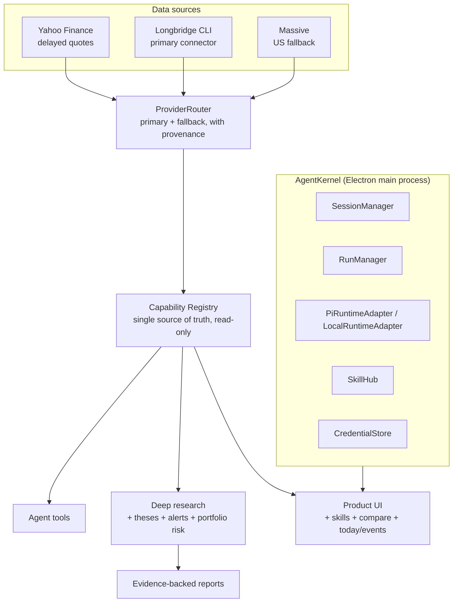

<div align="center">


<h1>Aster</h1>

<p><strong>A local-first, AI-native investment research workstation</strong></p>

<p>Market data, evidence, and judgment live in one desktop workspace: the agent can see the symbol you are looking at, every research report carries its sources, and every thesis can be re-checked later.</p>

<p><sub>Project timeline: 2026-04-05 → 2026-08-08</sub></p>

<p>
  <a href="https://github.com/xiaodu55/aster/releases"></a>
  
  
  
  
</p>

<p>
  <a href="README.md">简体中文</a> ·
  <a href="docs/architecture.md">Architecture</a> ·
  <a href="docs/PRD.md">PRD</a> ·
  <a href="CONTRIBUTING.md">Contributing</a>
</p>

</div>

---

## Why it exists

A quote terminal answers **what happened**. Aster is built to answer three different questions:

- **Why does this matter to you** — the agent knows the current page, symbol, and portfolio, so you never restate context.
- **What did you believe before** — a research report can be saved as an editable thesis with explicit assumptions.
- **What changed** — when new data lands, theses due for review, movers, and events surface on the Today page.

It is not a chat window with a finance skin: each tool call leaves a capability execution record and a source. When a provider fails, the answer states the data gap instead of inventing a plausible number.

## Timeline

| Milestone | Date |
| --- | --- |
| Start | 2026-04-05 |
| End | 2026-08-08 |

Current build: `0.4.0-beta.2` (Electron desktop app, macOS arm64).

## Shape of the product

Three columns, one shared context:

```text
+-----------+------------------------------------+----------------------+
| Navigation| Finance workspace                  | Agent copilot        |
| Today     | Watchlist / K-line / filings / news| session, model,      |
| Workbench | overview / research report         | thinking level,      |
| Research  |                                    | tool activity        |
| Theses    |                                    | source inspector     |
| Compare   |                                    |                      |
| Portfolio |                                    |                      |
+-----------+------------------------------------+----------------------+
```

Selecting a symbol moves the chart, overview, research, and agent context together. `⌘K` opens a command palette over pages, symbols, and actions.

## Features

| Area | Capability |
| --- | --- |
| **Research workspace** | Watchlist, quotes, K-line with moving averages and volume, filings, news, symbol overview; data source and freshness are labelled, missing values render as `—`, unavailable data states its reason |
| **Deep research** | Plan → bounded parallel capability calls (timeout, cancel) → data packet → model synthesis → `ResearchReport` with stance, confidence, bull/bear points, catalysts, risks, and per-claim execution records |
| **Strategies** | Comprehensive, value, growth, technical, earnings, event-driven, risk review, returns; research diff and multi-format export |
| **Theses** | Save a report as an editable thesis with assumptions, re-evaluate on new data, review reminders on the Today page |
| **Compare** | 2–4 symbols aligned on valuation, growth, margin, ROE, dividend, returns, rating, momentum |
| **Discover** | 17 deterministic screens (market movers, fundamentals, technicals, events) — rules, not model scanning |
| **Portfolio & risk** | Total assets, cash, allocation, cost and P&L; concentration, HHI, large positions, drawdown, exposure; import support |
| **Alerts & events** | Price, news, earnings, rating, dividend, weight, drawdown rules; earnings, macro, and central-bank calendar |
| **Agent copilot** | Persistent sessions and streaming answers on the Pi runtime, model and thinking-level switching, stop mid-run, expandable tool activity and source inspector |
| **Skills** | Skills declare required and optional capabilities and report ready / partial / disabled; missing capabilities are never presented as available |
| **Evaluation center** | Experiments, baselines, model comparisons, failure modes, case detail, human feedback; task completion, tool selection, evidence, latency, recovery, research completeness, decision usability |

### Read-only by design

The capability registry is the single source of truth for read-only capabilities: it generates agent tools, drives UI availability, and determines skill readiness. **No order or trading capability exists on the product path.**

### Sample data

Without a connected brokerage account, the portfolio and events pages use built-in sample data, marked with a "Sample data" badge. Samples never impersonate a connected account.

## Architecture



| Layer | Responsibility |
| --- | --- |
| **Main process** | `AgentKernel` (sessions, runs, event stream), market data service, alerts, credential store |
| **Preload** | Whitelisted `contextBridge` API |
| **Renderer** | React UI; subscribes to events and projects views — never writes sessions or runs |
| **Providers** | `ProviderResult` with normalized data plus provenance; the "Yahoo Finance · Delayed" label comes from this chain |
| **Models** | Pi runtime against a configured LLM provider; a deterministic local runtime covers development and offline paths |

Security boundary: `contextIsolation: true`, `nodeIntegration: false`, `sandbox: true`, IPC by channel whitelist. Credentials are encrypted with Electron `safeStorage` in the main process and are never read back into the renderer.

## Stack

| Concern | Choice |
| --- | --- |
| Desktop shell | Electron 39 + whitelisted preload bridge |
| Frontend | React 18, Vite, Tailwind CSS 4, Radix UI, Jotai |
| Language & tooling | TypeScript 5.6, Bun workspaces |
| Agent runtime | Pi Runtime (JSONL / stdio RPC) + deterministic local runtime |
| Data | Longbridge CLI (argv arrays + symbol validation), Yahoo Finance, Massive |
| Evaluation & tracing | Local evaluation backend, optional LangSmith / Langfuse |
| Packaging | electron-builder (macOS arm64, DMG + SHA256) |

## Quick start

Prerequisites: [Bun](https://bun.sh). Live Longbridge data needs the [Longbridge CLI](https://open.longbridge.com/longbridge/longbridge-terminal/install) — installed by the user, never bundled with the app. The Pi runtime needs an LLM provider; the deterministic local runtime does not.

```bash
git clone https://github.com/xiaodu55/aster.git
cd aster
bun install

# Dev mode: Electron renderer
bun run dev

# Deterministic local agent, no external model
ASTER_AGENT_PROVIDER=local bun run dev

# Offline demo: falls back to built-in sample data when providers are unavailable
ASTER_AGENT_PROVIDER=local ASTER_DEMO_DATA=1 bun run dev
```

> **Windows**: enable Developer Mode in a non-elevated terminal first, otherwise Bun may create empty `node_modules` directories or miss `tsc`.

Longbridge login happens in the terminal:

```bash
longbridge auth login
```

| Command | Purpose |
| --- | --- |
| `bun run dev` | Start the renderer in dev mode |
| `bun run typecheck` | Typecheck every workspace |
| `bun test` | Unit and integration tests |
| `bun run build` | Build packages, renderer, preload, main |
| `bun run test:e2e` | Electron golden-path E2E |
| `bun run eval:smoke` | Deterministic PR-level agent regression |
| `bun run eval:full` | Full agent benchmark |
| `bun run release:check` | Release gate checks |
| `bun run release:package` | Build macOS arm64 app, DMG, SHA256 |

## Evaluation

- `aster-agent-v1`: 86 cases across golden paths, hard cases, long tail, tool failures, regressions, and adversarial inputs; `deep-research-gold-v1` is the deep-research gold set.
- Dimensions: task completion, tool selection and arguments, evidence/provenance, latency, failure recovery, research completeness, decision usability.
- PRs run the deterministic `bun run eval:smoke`; the full benchmark runs on demand or on a schedule.
- Tracing is off by default; privacy level and keys are managed in Settings and never echoed back.

Evaluation measures engineering behavior, not investment returns.

## Security and boundaries

- Longbridge commands run from argv arrays, validate symbols first, and register read-only capabilities only.
- Skill resource paths reject traversal and symlink escapes.
- Research reports distinguish "data unavailable" from negative evidence and never fabricate missing numbers.
- External text entering a model prompt (news, filings, web pages) is sanitized for prompt injection; forged sentinels are stripped.
- Agent tracing is off by default; the standard privacy level redacts prompts, answers, arguments, and portfolio tool results.

## Repository layout

```text
aster/
├── apps/electron/          # Electron main, preload, renderer entry, E2E
├── packages/
│   ├── core/               # Domain models and contracts
│   ├── shared/             # Providers, portfolio risk, alerts, eval datasets
│   ├── ui/                 # React components, atoms, views
│   ├── longbridge-tools/   # Longbridge CLI wrapper: executor, validation, normalizer
│   ├── pi-extension/       # Pi agent tools and privacy handling
│   ├── skill-hub/          # Skill index and resource loading
│   └── i18n/               # Chinese and English copy
├── skills/                 # Shipped SKILL.md capability packs
├── docs/                   # Architecture, PRD, UI system, evaluation, release gates
└── scripts/                # Evaluation, release, CI scripts
```

## Docs

- [Architecture](docs/architecture.md) · [中文](docs/architecture.zh-CN.md)
- [PRD and invariants](docs/PRD.md)
- [Visual system](docs/UI-SYSTEM.md) · [中文](docs/UI-SYSTEM.zh-CN.md)
- [Evaluation methodology](docs/EVALUATION.md) · [CI policy](docs/EVALUATION-CI.md) · [Benchmark](docs/EVALUATION-BENCHMARK.md)
- [Longbridge auth](docs/longbridge-auth.md) · [Skill setup](docs/longbridge-skill-setup.md)
- [Yahoo Finance delayed data](docs/yahoo-finance.md)
- [Release gates](docs/release-gates.md) · [Provider decision](docs/provider-b-decision.md)

## Known limitations

- Only macOS arm64 is packaged; local builds are unsigned and may trip Gatekeeper on first launch.
- Filings, news, depth, HK/CN symbols, and brokerage positions require the Longbridge CLI; without it those areas state why they are unavailable.
- Deep research still produces a report when some capabilities fail, marked "partial", with correspondingly cautious confidence.
- Visual regression covers a single platform; cross-platform UI differences are not yet gated.

## Roadmap

- Cross-platform packaging and signed releases.
- More data providers under the same capability contract.
- Richer scheduled briefings, notification channels, and custom watch rules.
- Calibration samples and additional research strategies.

## Contributing

Issues and pull requests are welcome. Claim rules, commit conventions, PR descriptions, and test reports are in [CONTRIBUTING.md](CONTRIBUTING.md). Before submitting:

```bash
bun test
bun run typecheck
```

## Disclaimer

Aster is a research and decision-support tool; its output is not investment advice. Quotes may be delayed, and sample data is for demonstration only.
