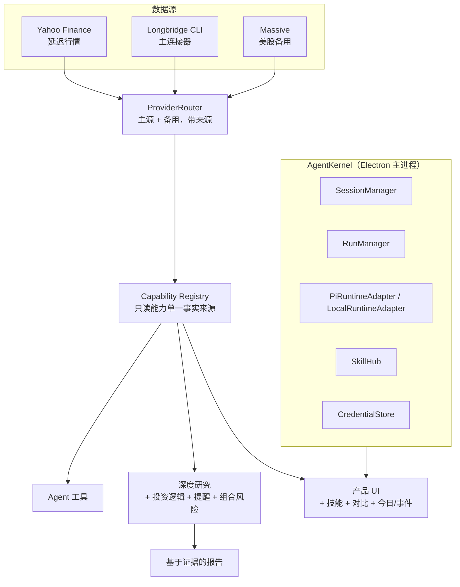

<div align="center">


<h1>Aster</h1>

<p><strong>本地优先的 AI 原生投资研究工作台</strong></p>

<p>行情、证据、判断留在同一个桌面工作区：Agent 看得见你正在看的标的，研究报告带来源，投资逻辑可以被复核。</p>

<p><sub>项目周期：2026-04-05 → 2026-08-08</sub></p>

<p>
  <a href="https://github.com/xiaodu55/aster/releases"></a>
  
  
  
  
</p>

<p>
  <a href="README.en.md">English</a> ·
  <a href="docs/architecture.zh-CN.md">架构</a> ·
  <a href="docs/PRD.md">产品需求</a> ·
  <a href="CONTRIBUTING.md">贡献指南</a>
</p>

</div>

---

## 为什么做这个

行情终端回答 **What happened**。Aster 想回答另外三件事：

- **Why does this matter to you** —— Agent 知道当前页面、当前标的和当前持仓，不需要你重复上下文。
- **What did you believe before** —— 研究报告可以保存成投资逻辑，写下论点和关键假设。
- **What changed** —— 新数据进来时，待复核的逻辑、异动和事件会汇总回今日页。

它不是一个“问一句答一句”的聊天窗口：Agent 的每次取数都会留下能力调用记录和来源，工具失败时说明数据缺口，而不是补一个看起来合理的数字。

## 项目周期

| 阶段 | 时间 |
| --- | --- |
| 开始 | 2026-04-05 |
| 结束 | 2026-08-08 |

当前交付版本：`0.4.0-beta.2`（Electron 桌面端，macOS arm64 打包）。

## 产品形态

三栏桌面布局，左右分工清晰：

```text
┌──────────┬──────────────────────────────────┬────────────────────┐
│ 导航      │ 金融工作区                        │ Agent 副驾驶        │
│ 今日      │ 自选 / K 线 / 财务报表 / 新闻      │ 会话 · 模型 · 思考等级│
│ 工作台    │ 概览 / 研究报告                    │ 工具活动 · 来源检查器 │
│ 深度研究  │                                  │                    │
│ 投资逻辑  │                                  │                    │
│ 对比/发现 │                                  │                    │
│ 组合/事件 │                                  │                    │
└──────────┴──────────────────────────────────┴────────────────────┘
```

选中一只标的，K 线、概览、研究和 Agent 上下文一起切换。任意页面按 `⌘K` 打开命令面板，搜索页面、标的和操作。

## 功能

| 模块 | 能力 |
| --- | --- |
| **研究工作区** | 自选、行情、K 线（均线 + 成交量）、财务报表、新闻、证券概览；标注数据来源与新鲜度，缺失值显示 `—`，不可用写明原因 |
| **深度研究** | 规划 → 有界并行的能力调用（超时、取消）→ 数据包 → 模型综合 → `ResearchReport`；含立场、置信度、论多/论空、催化剂、风险，每条论断带能力执行记录 |
| **研究策略** | 综合、价值、成长、技术、财报、事件驱动、风险复盘、收益八种；支持研究差异对比与多格式导出 |
| **投资逻辑** | 报告一键保存为可编辑的论点与假设，新数据到达后重新评估，今日页列出待复核项 |
| **多标的对比** | 2–4 只标的按估值、成长、利润率、ROE、股息、回报、评级、动量对齐 |
| **机会发现** | 17 个确定性筛选任务（市场异动、基本面、技术面、事件），规则驱动而非模型扫描 |
| **组合与风险** | 总资产、现金、配置、成本与盈亏；配置、集中度、赫芬达尔指数、大额持仓、回撤与敞口分析；支持导入持仓 |
| **提醒与事件** | 价格、新闻、财报、评级、股息、权重、回撤规则；事件页汇总财报、宏观与央行日历 |
| **Agent 副驾驶** | Pi 运行时上的持久会话与流式回答，可切换模型与思考等级、运行中停止；工具活动与来源检查器可展开核对 |
| **技能中心** | 技能声明必需/可选能力，显示就绪、部分就绪与已禁用；缺少的能力不会被说成可用 |
| **评测中心** | 实验、基线、模型对比、失败模式、案例详情与人工反馈；指标覆盖任务完成、工具选择、证据、时延、失败恢复等 |

### 只读边界

能力注册表是只读能力的单一事实来源：它同时生成 Agent 可调用的工具、驱动 UI 可用性和技能就绪判定。**产品路径里没有下单或交易能力。**

### 示例数据

未接入券商账户时，投资组合与事件页使用内置示例数据，并在界面上显示「示例数据」标记。示例不会冒充已连接账户。

## 架构



| 层 | 职责 |
| --- | --- |
| **主进程** | `AgentKernel`（会话、运行、事件流）、行情服务、提醒、凭证库 |
| **预加载** | 白名单化的 `contextBridge` API |
| **渲染进程** | React UI，只订阅事件并做视图投影，不直接写会话或运行 |
| **提供方** | 返回规范化数据和来源的 `ProviderResult`，界面上的「Yahoo Finance · Delayed」来自这条链路 |
| **模型** | Pi 运行时对接已配置的 LLM 提供方；开发与离线路径可用确定性本地运行时 |

安全边界：`contextIsolation: true`、`nodeIntegration: false`、`sandbox: true`，IPC 按通道白名单。凭证在主进程用 Electron `safeStorage` 加密，渲染进程读不回明文。

## 技术栈

| 领域 | 选型 |
| --- | --- |
| 桌面壳 | Electron 39 + 白名单 preload 桥 |
| 前端 | React 18、Vite、Tailwind CSS 4、Radix UI、Jotai |
| 语言与工具链 | TypeScript 5.6、Bun workspaces |
| Agent 运行时 | Pi Runtime（JSONL / stdio RPC）+ 本地确定性运行时 |
| 数据 | Longbridge CLI（argv 数组执行 + 标的校验）、Yahoo Finance、Massive |
| 评测与追踪 | 本地 Evaluation Backend，可选 LangSmith / Langfuse |
| 打包 | electron-builder（macOS arm64，DMG + SHA256） |

## 快速开始

前置条件：[Bun](https://bun.sh)。实时 Longbridge 数据需要 [Longbridge CLI](https://open.longbridge.com/longbridge/longbridge-terminal/install)（用户自行安装，不随应用打包）；Pi 运行时需要一个 LLM 提供方，确定性本地运行时不需要。

```bash
git clone https://github.com/xiaodu55/aster.git
cd aster
bun install

# 开发模式：启动 Electron 渲染进程
bun run dev

# 确定性本地 Agent，不需要外部模型
ASTER_AGENT_PROVIDER=local bun run dev

# 离线演示：真实提供方不可用时回退到内置示例数据
ASTER_AGENT_PROVIDER=local ASTER_DEMO_DATA=1 bun run dev
```

> **Windows**：在普通（非管理员）终端下先开启「开发人员模式」，否则 Bun 安装 workspace 符号链接依赖时可能出现 `node_modules` 空目录或 `tsc not found`。

长桥登录在终端完成：

```bash
longbridge auth login
```

| 命令 | 说明 |
| --- | --- |
| `bun run dev` | 开发模式启动渲染进程 |
| `bun run typecheck` | 全工作区类型检查 |
| `bun test` | 单元与集成测试 |
| `bun run build` | 构建包、渲染进程、预加载与主进程 |
| `bun run test:e2e` | Electron 黄金路径 E2E |
| `bun run eval:smoke` | PR 级确定性 Agent 回归 |
| `bun run eval:full` | 完整 Agent benchmark |
| `bun run release:check` | 发布门槛检查 |
| `bun run release:package` | 构建 macOS arm64 应用、DMG 与 SHA256 |

## 评测

- `aster-agent-v1`：86 个用例，覆盖黄金路径、困难、长尾、工具失败、回归与对抗场景；另有深度研究金标集 `deep-research-gold-v1`。
- 维度：任务完成、工具选择与参数、证据/来源、时延、失败恢复、研究完整性、决策可用性。
- PR 使用确定性的 `bun run eval:smoke`；完整 benchmark 按需或定时运行。
- 追踪默认关闭，隐私级别与密钥在设置中单独管理，界面不回显密钥。

评测衡量的是工程行为，不是收益承诺。

## 安全与产品边界

- Longbridge 命令使用 argv 数组执行、执行前校验标的，并只注册只读能力。
- 技能资源路径拒绝路径穿越和符号链接逃逸。
- 研究报告区分「数据不可用」与负面证据，不编造缺失数字。
- 进入模型提示词的外部文本（新闻、财报、网页）做注入清洗，伪造的哨兵标记会被剥离。
- Agent 追踪默认关闭；标准隐私级别会脱敏 prompt、答案、参数和组合工具结果。

## 目录结构

```text
aster/
├── apps/electron/          # Electron 主进程、preload、渲染进程入口与 E2E
├── packages/
│   ├── core/               # 领域模型与契约（会话、能力、研究、证据）
│   ├── shared/             # 提供方、组合风险、提醒、评测数据集
│   ├── ui/                 # React 组件、原子状态、视图
│   ├── longbridge-tools/   # Longbridge CLI 封装：执行器、校验、规范化
│   ├── pi-extension/       # Pi Agent 工具与隐私处理
│   ├── skill-hub/          # 技能索引与资源加载
│   └── i18n/               # 中英文文案
├── skills/                 # 随应用分发的 SKILL.md 能力包
├── docs/                   # 架构、PRD、UI 系统、评测、发布门槛
└── scripts/                # 评测、发布与 CI 脚本
```

## 文档

- [系统架构](docs/architecture.zh-CN.md) · [English](docs/architecture.md)
- [产品需求与不变式](docs/PRD.md)
- [视觉系统与组件规则](docs/UI-SYSTEM.zh-CN.md) · [English](docs/UI-SYSTEM.md)
- [Agent 评测方法](docs/EVALUATION.md) · [CI 策略](docs/EVALUATION-CI.md) · [基准集](docs/EVALUATION-BENCHMARK.md)
- [Longbridge 认证](docs/longbridge-auth.zh-CN.md) · [技能安装与能力覆盖](docs/longbridge-skill-setup.zh-CN.md)
- [Yahoo Finance 延迟行情](docs/yahoo-finance.zh-CN.md)
- [发布验证清单](docs/release-gates.zh-CN.md) · [提供方决策](docs/provider-b-decision.zh-CN.md)

## 已知限制

- 当前只提供 macOS arm64 打包；本地构建未签名，首次启动可能触发系统安全提示。
- 财报、新闻、盘口、港股/A 股和券商持仓依赖 Longbridge CLI；未安装时这些区域显示不可用并说明原因。
- 深度研究的部分能力失败时仍会出报告，状态标记为「部分运行」，置信度相应保守。
- 视觉回归只覆盖单一平台，跨平台界面差异尚未建立自动化回归。

## 路线图

- 跨平台打包与签名发布。
- 同一能力契约下接入更多数据提供方。
- 更丰富的定时简报、通知渠道与自定义监控规则。
- 研究结果的校准样本与更多策略。

## 贡献

欢迎 Issue 和 Pull Request。认领规则、commit 规范、PR 描述与测试报告要求见 [CONTRIBUTING.md](CONTRIBUTING.md)。提交前请运行：

```bash
bun test
bun run typecheck
```

## 免责声明

Aster 是研究与决策支持工具，输出不构成投资建议。行情可能延迟，示例数据仅用于演示。
